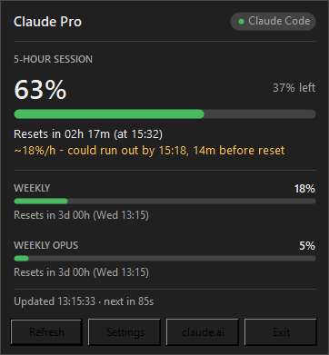
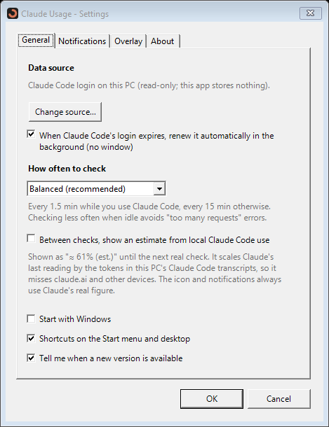

# Claude Usage Tray

[](https://github.com/charitty-ccrp/ClaudeUsageTray/releases/latest)
[](https://github.com/charitty-ccrp/ClaudeUsageTray/actions/workflows/ci.yml)
[](LICENSE)

A small Windows tray app that shows how much of your Claude **5-hour** and **weekly** limits you've used. You don't need to open claude.ai to see it.

**[⬇ Download the latest version](https://github.com/charitty-ccrp/ClaudeUsageTray/releases/latest)** · [ภาษาไทย](#ภาษาไทย)

 

- The tray icon is a ring that fills up and changes colour: green, then yellow at 70%, orange at 85% and red at 95%. The number sits inside the ring.

  
- Click the icon for details: when the limit resets, the weekly bars, and a "could run out by" estimate.
- Optional notifications when usage crosses 70%, 85% or 95%, and when a limit resets. Quiet hours can hold them back.
- When Claude Code's login expires, it is renewed automatically in the background. No window opens.
- Optional: an always-on-top desktop overlay, and a clearly labelled "≈ 61% (est.)" between checks, worked out from your local Claude Code use. The icon colour and notifications always use Claude's real figure.

## Download and install

Go to **[Releases → latest](https://github.com/charitty-ccrp/ClaudeUsageTray/releases/latest)** and download **one** of these:

| File | Choose it if |
|---|---|
| `ClaudeUsageTraySetup-<version>.exe` **(recommended)** | You want a normal install: Start menu entry, optional desktop shortcut and start with Windows, uninstall from Windows Settings. It installs for your account only, so no administrator rights are needed. |
| `ClaudeUsageTray-<version>-portable.exe` | You don't want to install anything. Put it in a folder you'll keep (for example Documents) and double-click it. On first run it offers Start menu and desktop shortcuts. |

**Requirements:** Windows 10 or 11 (64-bit), and either Claude Code signed in on this PC (recommended) or a claude.ai account. You don't need to install .NET.

**"Windows protected your PC"?** The files aren't code-signed (a certificate costs money), so Windows SmartScreen may warn the first time. Click **More info → Run anyway**. To check that your download is the genuine file, compare it with `SHA256SUMS.txt` on the same release page:

```powershell
Get-FileHash .\ClaudeUsageTraySetup-0.2.0.exe
```

**First run:** the setup window finds your Claude Code login and tests it. Press **Start monitoring**, and the icon appears in the tray. It may be hidden under the **^** arrow; drag it onto the taskbar to keep it visible.

**Uninstall:** for the installer, use Windows **Settings → Apps → Installed apps → Claude Usage Tray**. For the portable file, turn off the shortcuts in Settings → General, then delete the file. Settings and logs are in `%LOCALAPPDATA%\ClaudeUsageTray`.

## Where the numbers come from

| Source | When to use it |
|---|---|
| **Claude Code login** (recommended) | You use Claude Code or the Claude desktop app's Code tab on this PC. The app reads the login Claude Code keeps in `~/.claude/.credentials.json` at each check. It never copies, stores, logs or refreshes it. |
| claude.ai session cookie (Advanced) | You don't use Claude Code. You paste your `sessionKey` cookie once. It's stored encrypted with Windows DPAPI for your account only, and lasts about 30 days. |

Both sources use **undocumented** endpoints, the same data Claude Code's `/usage` command shows. They may change or stop working at any time. Anthropic's terms or your organization's policy may restrict this kind of use, so use it at your own risk. This project is not affiliated with Anthropic.

### How often it checks

Usage only changes while Claude is in use, so the app watches for Claude Code activity on this PC (writes to its transcript files) and adapts:

| Setting | While you use Claude Code | Otherwise |
|---|---|---|
| Balanced (default) | every 1.5 min | every 15 min |
| Frequent | every 1 min | every 5 min |
| Saver | every 3 min | every 30 min |

It pauses while the PC is locked. It waits for the network after sleep. If Claude says "too many requests", it backs off for as long as Claude asks. A single failed check never shows an error: the last value stays on screen, and a problem only shows after 3 failed checks or 5 minutes. Usage from claude.ai or other devices still appears at the next check.

## Privacy

- Nothing is sent anywhere except to Claude (`api.anthropic.com` or `claude.ai`) to read usage. Once a day the app also asks `api.github.com` whether a newer version exists; you can turn this off in Settings. That request carries no credential or usage data.
- Settings live in `%LOCALAPPDATA%\ClaudeUsageTray\config.json`, and logs in `...\logs`. Credentials are redacted from logs.
- **Copy diagnostics** in the tray menu copies the version, settings summary and the last 50 log lines, with credentials redacted, for bug reports.

## Troubleshooting

| You see | Do this |
|---|---|
| "Claude Code login needed" | Usually nothing: the app renews Claude Code's login by itself in the background (it runs `claude auth status` with no window, and Claude Code renews its own token). If that fails, a notification says so: use **Sign in to Claude Code...** in the tray menu. |
| "Checking too often" | Nothing to do: it waits as long as Claude asks. If it keeps happening, switch to **Saver** in Settings. |
| "Access blocked" (cookie mode) | claude.ai showed a Cloudflare check. Switch to the Claude Code login if you can. |
| Icon shows `!` | No data yet. Hover the icon or open the popup for the reason. |

## Build from source

Requires the .NET 10 SDK (see `global.json`).

```bash
dotnet test
```

```bash
dotnet publish src/ClaudeUsageTray -p:PublishProfile=win-x64
```

The second command writes a single self-contained `artifacts/publish/ClaudeUsageTray.exe`. The installer is built with [Inno Setup 6](https://jrsoftware.org/isinfo.php):

```bash
iscc /DAppVersion=0.2.0 installer/ClaudeUsageTray.iss
```

Pushing a `v*` tag runs `.github/workflows/release.yml`, which tests, publishes, builds the installer and attaches both downloads and `SHA256SUMS.txt` to a GitHub release. Running the same workflow by hand (Actions → Release → Run workflow) is a dry run: it builds everything and keeps the files as a workflow artifact without publishing a release.

The app icon is drawn in code (`src/ClaudeUsageTray/UI/AppIcon.cs`). After changing it, regenerate the icon embedded in the .exe:

```bash
src/ClaudeUsageTray/bin/Debug/net10.0-windows/ClaudeUsageTray.exe --write-icon assets/app.ico
```

Run with `--mock` to try the UI with made-up data and no credentials.

To build only the portable .exe, double-click `build-portable.cmd`. It opens Explorer on `artifacts\publish\ClaudeUsageTray.exe` when done.

## ภาษาไทย

**Claude Usage Tray** คือโปรแกรมเล็ก ๆ บน Windows ที่แสดงว่าคุณใช้โควตา Claude แบบ **5 ชั่วโมง** และ **รายสัปดาห์** ไปแล้วกี่เปอร์เซ็นต์ โดยแสดงเป็นไอคอนวงแหวนที่มุมขวาล่างของจอ (system tray) ไม่ต้องเปิด claude.ai

**ดาวน์โหลดและติดตั้ง**
1. ไปที่ **[Releases → latest](https://github.com/charitty-ccrp/ClaudeUsageTray/releases/latest)**
2. ดาวน์โหลดไฟล์ใดไฟล์หนึ่ง:
   - `ClaudeUsageTraySetup-<เวอร์ชัน>.exe` **(แนะนำ)** เป็นตัวติดตั้งแบบโปรแกรมทั่วไป มีเมนู Start และถอนการติดตั้งได้ ไม่ต้องใช้สิทธิ์ admin
   - `ClaudeUsageTray-<เวอร์ชัน>-portable.exe` เป็นไฟล์เดียว ดับเบิลคลิกเปิดได้เลยโดยไม่ต้องติดตั้ง เปิดครั้งแรกจะถามว่าจะสร้างทางลัดไหม
3. ถ้าขึ้นหน้าจอ **"Windows protected your PC"** ให้กด **More info → Run anyway** ที่ขึ้นเพราะไฟล์ยังไม่ได้เซ็นด้วยใบรับรอง ถ้าต้องการเช็กว่าไฟล์ถูกต้อง ให้เทียบค่า hash กับไฟล์ `SHA256SUMS.txt` ในหน้าเดียวกัน
4. เปิดโปรแกรม หน้าต่างตั้งค่าจะหา login ของ Claude Code ให้เอง กด **Start monitoring** แล้วไอคอนจะขึ้นที่ถาด ถ้าไม่เห็น ให้กดลูกศร **^** ที่ taskbar

**ความต้องการของระบบ:** Windows 10 หรือ 11 แบบ 64-bit และมี Claude Code login อยู่ในเครื่อง (แนะนำ) หรือมีบัญชี claude.ai ไม่ต้องติดตั้ง .NET

**ถอนการติดตั้ง:** ถ้าใช้ตัวติดตั้ง ไปที่ Settings → Apps → Installed apps → Claude Usage Tray ถ้าใช้ไฟล์ portable ให้ปิดทางลัดใน Settings ของโปรแกรมแล้วลบไฟล์ทิ้ง

**พบปัญหา:** คลิกขวาที่ไอคอน → **Copy diagnostics** (ข้อมูล login ถูกลบออกให้แล้ว) แล้วเปิด [issue ใหม่](https://github.com/charitty-ccrp/ClaudeUsageTray/issues/new/choose) ห้ามแปะ token หรือ cookie ลงใน issue เด็ดขาด

โปรแกรมนี้ไม่ได้เกี่ยวข้องกับ Anthropic และอ่านตัวเลขจาก endpoint ที่ไม่มีเอกสารอย่างเป็นทางการ ซึ่งอาจเปลี่ยนหรือหยุดทำงานได้

## License

[MIT](LICENSE) © 2026 Charittiporn Chamcharoenporn. Not affiliated with Anthropic.
